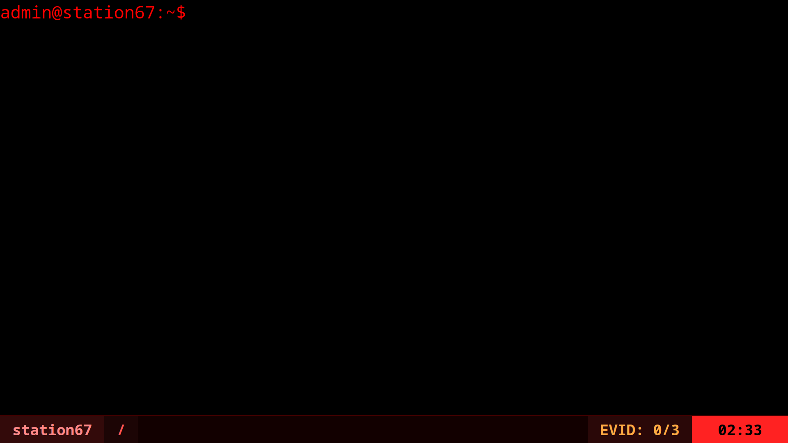

# station67



a short terminal horror game made in vanilla js.

it's 2:57 am on halloween. the old broadcast tower on blackwood ridge just turned back on and everyone in the valley is passed out in front of their TVs. you broke into the station, the transmitter is overheating, and the thermite purge goes off at 3:00 am.

you have 3 minutes to search around the filesystem, find the vault pin, grab 3 evidence files, and get out.

### Features
- a tree based virtual filesystem (`fs.js`)
- mechanical keyboard sounds on keydown/keyup using web audio api (the code and sound is taked from [sheets.works](https://sheets.works/data-viz/keyboard-sounds))
- hidden youtube iframe for ambient noise
- vim style statusline at the bottom for path, evidence and timer
  
### Commands
- `ls` - list files/folders
- `cd <dir>` - change directory
- `cat <file>` - read a file (automatically grabs evidence if it's a target file)
- `unlock <pin>` - unlock the `/vault` folder
- `extract` - win the game once you have all 3 files
- `clear`, `echo`, `help`

### Running it locally

```bash
python3 -m http.server 8000
# or use the VS Code Live Server extension
```
then open `127.0.0.1:8000`